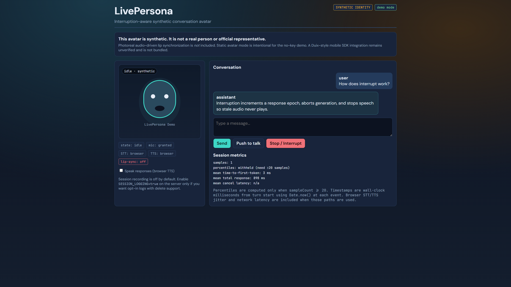

# LivePersona

**LivePersona** is an interactive synthetic-avatar conversation app with an **interruption-aware** state machine. Type or speak a question, get a streamed reply, optionally hear browser TTS, and interrupt at any time without stale audio or obsolete responses.

> Category inspiration: [Duix-Mobile](https://github.com/duixcom/Duix-Mobile) (custom community license). This repository is an **original** implementation. Photoreal on-device lip sync is **not** bundled and is documented as an unverified future integration.



## Why it exists

Many avatar demos ignore barge-in, hide whether lip-sync is real, or require paid SDKs before anything works. LivePersona ships a labeled static-avatar demo mode with real cancellation semantics and modular providers.

## Features (MVP)

- Typed dialogue in offline **demo mode** (no API key)
- Optional OpenAI-compatible streamed LLM on the server
- Browser push-to-talk STT + Speech Synthesis TTS when available
- Conversation states: listening → transcribing → generating → speaking → interrupted → recovering
- Epoch-based cancellation so late tokens never speak
- Session metrics from real timestamps (percentiles only at ≥20 samples)
- Synthetic identity banner; session logging off by default
- Framework-independent `@livepersona/core` for future mobile clients

## System requirements

- Node.js 20+
- Modern Chromium-based browser recommended for Web Speech
- Optional: OpenAI-compatible API key

## Quick start (Windows PowerShell)

```powershell
cd C:\Users\Dell\Desktop\LivePersona
Copy-Item .env.example .env
npm install
npm run build -w @livepersona/core
npm test
npm run dev
```

- UI: http://localhost:5174  
- API: http://127.0.0.1:8790  

### Optional real LLM backend

```env
MODEL_PROVIDER=openai
OPENAI_API_KEY=sk-...
OPENAI_BASE_URL=https://api.openai.com/v1
OPENAI_MODEL=gpt-4o-mini
```

## Demo workflow

1. Open the UI — confirm **SYNTHETIC IDENTITY** and **demo mode** badges.
2. Type `How does interrupt work?` and Send.
3. While generating or speaking, press **Stop / Interrupt**.
4. Confirm no stale continuation appears; metrics show cancel latency when available.
5. Optionally try **Push to talk** (mic permission required).

## Avatar honesty

| Feature | Status |
| ------- | ------ |
| Static synthetic avatar | Implemented |
| Speaking pulse during TTS | Implemented (heuristic, not lip-sync) |
| Photoreal Duix-style lip sync | Not implemented / unverified |

See [`docs/AVATAR_FEATURES.md`](docs/AVATAR_FEATURES.md).

## Architecture

```
packages/core   State machine, metrics, demo stream (no UI)
apps/server     Express + LLM proxy + optional session logs
apps/web        React avatar UI, STT/TTS, interrupt controls
```

## License

MIT for LivePersona original code. Duix materials are not included; their license is separate and more restrictive.

## Docs

- [`docs/PRODUCT_SPEC.md`](docs/PRODUCT_SPEC.md)
- [`docs/ARCHITECTURE.md`](docs/ARCHITECTURE.md)
- [`docs/TEST_PLAN.md`](docs/TEST_PLAN.md)
- [`docs/KNOWN_LIMITATIONS.md`](docs/KNOWN_LIMITATIONS.md)
- [`CONTRIBUTING.md`](CONTRIBUTING.md)
- [`CHANGELOG.md`](CHANGELOG.md)

---

<p align="center">
  <strong>Built by Laith Abu-Saleem</strong><br/>
  <a href="https://github.com/laithabusaleem">github.com/laithabusaleem</a>
</p>
